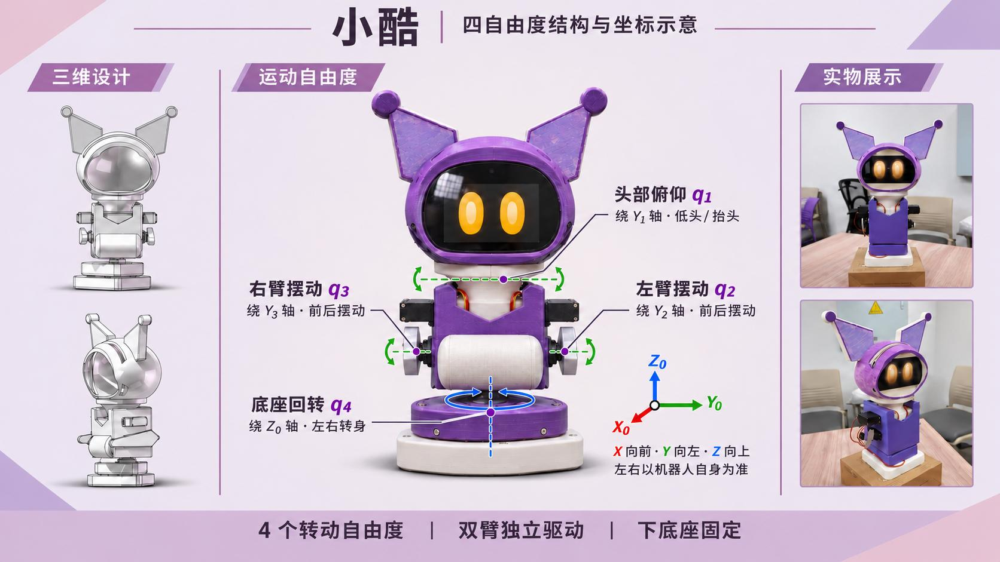
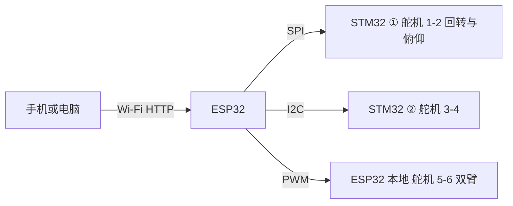
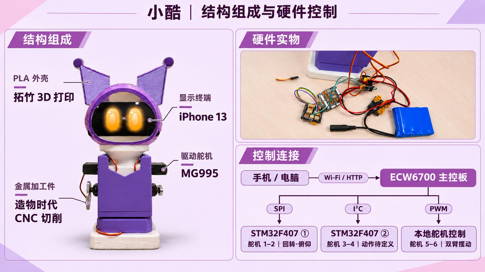
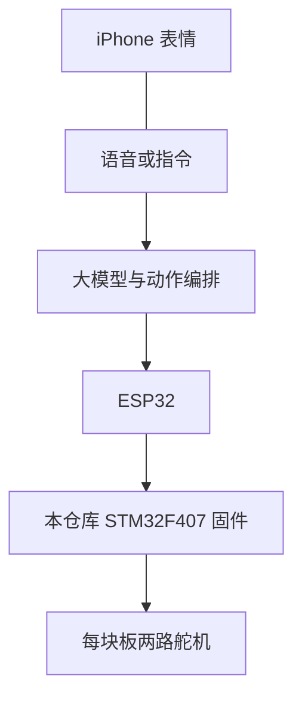
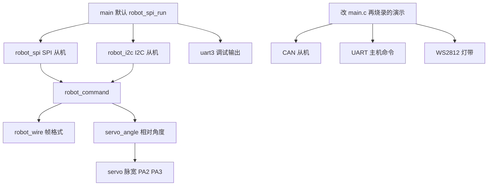
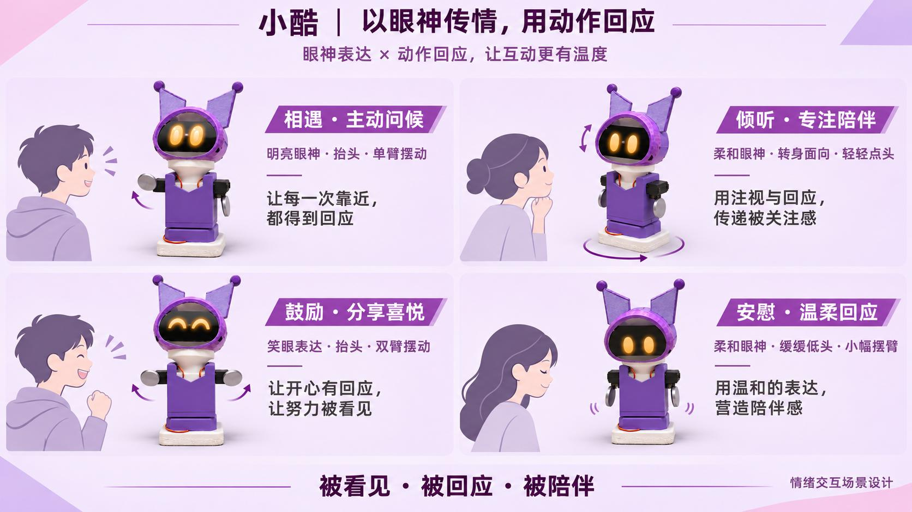
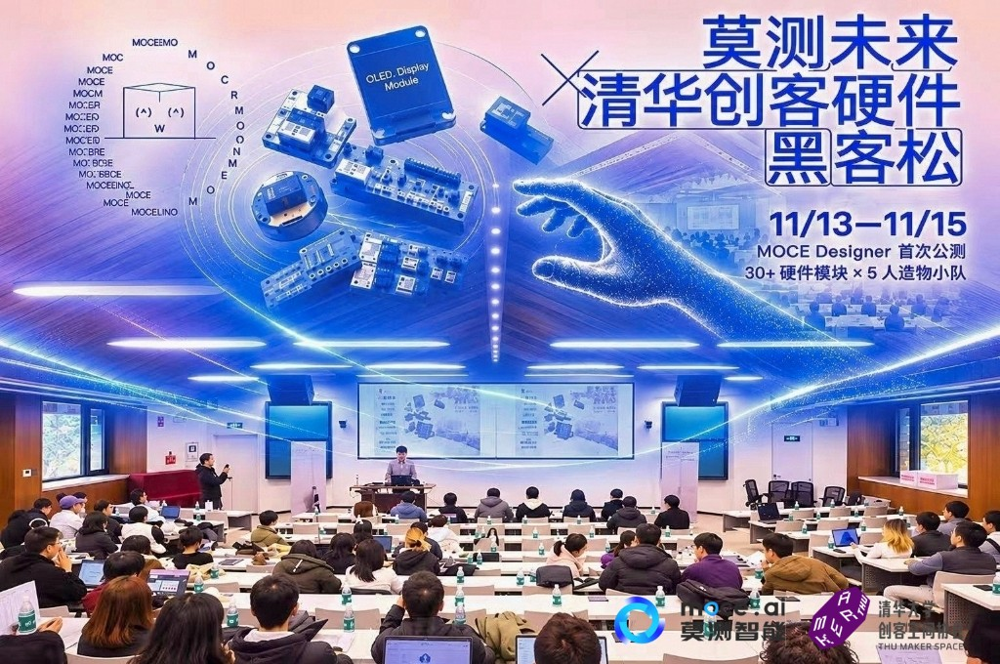

# hirobot

小酷是会聊天、会跳舞的四自由度桌面机器人。

演示视频:
[](https://www.youtube.com/shorts/TLvZFpn7x3Y)

这个仓库是小酷的 STM32F407 执行固件，烧录到两块相同的 STM32 上，负责接收命令并驱动舵机。

## 小酷是什么

小酷用抬头、转体和双臂摆动回应人。四个转动自由度是：

- q1 头部俯仰，绕 Y1 轴抬头、低头
- q2 左臂摆动，绕 Y2 轴前后摆
- q3 右臂摆动，绕 Y3 轴前后摆
- q4 底座回转，绕 Z0 轴左右转身

下底座固定，双臂各自驱动。外壳是拓竹打印的 PLA，关节件由造物时代 CNC 加工，舵机为 MG995，脸上的表情屏是 iPhone 13。



手机或电脑通过 Wi-Fi / HTTP 把指令交给 ESP32。ESP32 再分成三条执行路径：





## 这个仓库做什么

本仓库是上图里两块 STM32 的固件。两块板烧同一份程序，每块用 PA2、PA3 驱动两路舵机。ESP32 发命令时选择 SPI 或 I²C；默认程序 `robot_spi_run()` 在主循环里轮询这两个接口。

线上是 32 字节帧。`mode 10` 把两路相对转角写成脉宽，0° 对应 1500 µs，范围 ±90°。`mode 1` 做加法诊断，不驱动舵机。



语音理解、动作编排、Wi-Fi 和表情在手机与 ESP32 侧。ESP32 命令 `11,a,b` 发到 SPI 板，`12,a,b` 发到 I²C 板；`13,a,b` 由 ESP32 本地 PWM 驱动双臂。`a,b` 是两路相对转角，单位为度。`1,a,b` 和 `2,a,b` 分别是 SPI 板、I²C 板的加法诊断。

| ESP32 命令 | 目标 |
|---|---|
| `11,a,b` | SPI 连接的 STM32 两路舵机 |
| `12,a,b` | I²C 连接的 STM32 两路舵机 |
| `13,a,b` | ESP32 本地两路舵机，由 ESP32 自己的 PWM 输出 |

## 模块

默认固件从 `main()` 进入 `robot_spi_run()`。CAN、串口主机和灯带在源码里，要改 [`src/main.c`](src/main.c) 的调用再单独烧录。



| 模块 | 文件 | 默认固件 |
|---|---|---|
| SPI 从机 | [`src/components/robot_spi.c`](src/components/robot_spi.c) | 是 |
| I²C 从机 | [`src/components/robot_i2c.c`](src/components/robot_i2c.c) | 是 |
| 命令处理 | [`src/components/robot_command.c`](src/components/robot_command.c) | 是 |
| 32 字节帧 | [`src/components/robot_wire.h`](src/components/robot_wire.h) | 是 |
| 相对角度 | [`src/components/servo_angle.c`](src/components/servo_angle.c) | 是 |
| 舵机脉宽 | [`src/components/servo.c`](src/components/servo.c) | 是 |
| 调试串口 | [`src/components/uart3.c`](src/components/uart3.c) | 是 |
| CAN、串口主机、灯带等演示 | [`src/tests/`](src/tests/) | 改 `main` 后烧录 |

## 演示



## Windows 编译与烧录

在本目录打开 PowerShell，先把待烧录 STM32 的 **BOOT0 设为1，并按一次 RESET**，然后执行：

```powershell
.\flash.ps1 -Build -Port COM14
```

此命令先编译，成功后才烧录并回读校验；编译失败会停止。将 `COM14` 换成实际下载串口。成功后将 **BOOT0 恢复为0，再按 RESET** 运行程序。

也可以分开执行，确认编译成功后再烧录：

```powershell
.\build.ps1
.\flash.ps1 -Port COM14
```

只编译并检查镜像，不连接串口、不烧录：

```powershell
.\flash.ps1 -Build -Port COM14 -CheckOnly
```

产物为 `build/dual_link/hirobot_dual.bin` 和 `hirobot_dual.elf`。工具默认使用本机的 Python、ARM 编译器及相邻 ECW 工程中的烧录依赖；自定义路径、依赖和备份说明见 [Windows 详细说明](WINDOWS.md)。

## STM32 接线

| 功能 | STM32 芯片引脚 |
|---|---|
| SPI SCK / MISO / MOSI | PB3 / PB4 / PB5 |
| SPI CS | PD7 |
| I²C SCL / SDA | **PB8 / PB9** |
| 两路舵机信号 | PA2 / PA3 |

I²C 7位地址为 `0x32`，速率100kHz。两端共地，SCL/SDA 需要上拉至3.3V；接口针序按板上标识和套件映射确认。两块相同固件的 STM32 不应同时接到同一条 I²C 总线，因为地址相同。

## macOS

现有 `Makefile` 和 `flash.sh` 使用 macOS STM32CubeIDE 工具路径。在具备对应工具链的 macOS 上可执行：

```bash
make && ./flash.sh
```

该流程使用 `build/hirobot.bin`，与 Windows 的产物路径不同；`flash.sh` 本身不编译。BOOT0 和 RESET 的操作同上。

## 获奖

小酷在「莫测未来 × 清华创客硬件黑客松」（11 月 13–15 日）获得二等奖。


